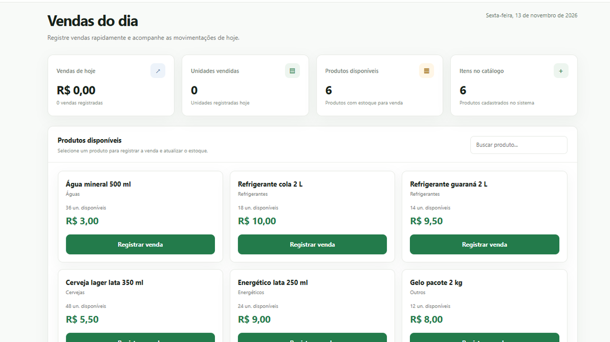

# 📦 StockFlow — Inventory & Sales Management

**A functional inventory and sales management web application, adapted from a real commercial project.**

🇺🇸 **English** | [🇧🇷 Português](README.pt-BR.md)

---

## 🌐 Live Demo

**[Try StockFlow Online](https://mathttk.github.io/stockflow-demo/)**

StockFlow is a web-based application designed to simplify inventory management, sales tracking, and financial monitoring.

This public demonstration uses a fictional brand and sample data while preserving the core business logic of the original commercial project.

## 📸 Screenshot

## ✨ Features

- Product registration and management
- Inventory tracking and stock movements
- Sales recording
- Expense tracking
- Financial indicators
- Local access protection for selected sections
- Demo reset with sample data

## 🛠️ Technologies

- HTML5
- CSS3
- JavaScript
- LocalStorage
- No backend required

## 🚀 Getting Started

1. Download or clone this repository.
2. Open `index.html` in a modern web browser.
3. Explore the application using the six sample products.
4. Create a local username and password when accessing protected sections.
5. Use **Restaurar demonstração** to reset the demo.

You can also access the application directly through GitHub Pages.

## 💾 Data Storage

StockFlow stores its demonstration data in the browser's `localStorage`.

- Data is stored locally in each browser.
- Data is not synchronized between devices.
- Clearing browser storage may remove saved information.
- Resetting the demo restores the initial sample data and local login state.

## 🔒 Security & Limitations

This is a public demonstration, not a production-ready hosted business system.

The local login is an interface-level access barrier, **not server-side authentication**.

Do not enter sensitive information, confidential business data, or passwords used for other services.

The application preserves business rules from the original project, but this public adaptation has not undergone comprehensive security and functional testing.

## 🎨 Design

StockFlow features a light interface with white backgrounds, subtle gray surfaces, and green accents inspired by its visual identity.

---

**Developed by [Matheus](https://github.com/Mathttk)**

[🌐 Portfolio](https://mathttk.github.io/portfolio/) | [💻 GitHub](https://github.com/Mathttk)
