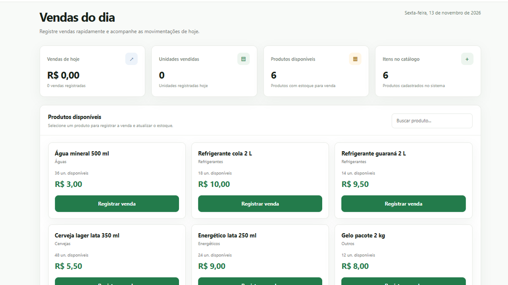

# 📦 StockFlow — Gestão de Estoque e Vendas

**Sistema web funcional de gestão de estoque e vendas, adaptado de um projeto comercial real.**

[🇺🇸 English](README.md) | 🇧🇷 **Português**

---

## 🌐 Demonstração Online

**[Testar StockFlow](https://mathttk.github.io/stockflow-demo/)**

O StockFlow é uma aplicação web desenvolvida para facilitar o gerenciamento de estoque, o registro de vendas e o acompanhamento de resultados financeiros.

Esta versão pública utiliza identidade visual fictícia e dados de exemplo, preservando as principais regras de negócio do projeto comercial original.

## 📸 Captura de Tela

## ✨ Funcionalidades

- Cadastro e gerenciamento de produtos
- Controle de estoque e movimentações
- Registro de vendas
- Controle de despesas
- Indicadores financeiros
- Proteção local de acesso a determinadas seções
- Restauração dos dados de demonstração

## 🛠️ Tecnologias

- HTML5
- CSS3
- JavaScript
- LocalStorage
- Sem necessidade de backend

## 🚀 Como Executar

1. Baixe ou clone este repositório.
2. Abra o arquivo `index.html` em um navegador moderno.
3. Explore o sistema utilizando os seis produtos fictícios.
4. Crie um usuário e uma senha locais para acessar as seções protegidas.
5. Utilize **Restaurar demonstração** para redefinir os dados.

O sistema também está disponível pelo GitHub Pages.

## 💾 Armazenamento de Dados

O StockFlow utiliza o `localStorage` do navegador para armazenar os dados da demonstração.

- Os dados ficam armazenados localmente.
- Não existe sincronização entre dispositivos.
- A limpeza dos dados do navegador pode apagar as informações.
- A restauração recupera os produtos fictícios e redefine o login local.

## 🔒 Segurança e Limitações

Esta é uma versão pública demonstrativa, não um sistema empresarial hospedado pronto para produção.

O login local funciona como uma barreira de acesso na interface, **não como autenticação segura de servidor**.

Não utilize dados confidenciais, informações pessoais ou senhas utilizadas em outros serviços.

As regras de negócio foram preservadas do projeto original, mas esta adaptação ainda não passou por testes completos de segurança e funcionamento.

## 🎨 Identidade Visual

O StockFlow utiliza um tema claro, com fundo branco, superfícies em cinza suave e detalhes verdes alinhados à identidade visual da marca.

---

**Desenvolvido por [Matheus](https://github.com/Mathttk)**

[🌐 Portfólio](https://mathttk.github.io/portfolio/) | [💻 GitHub](https://github.com/Mathttk)
